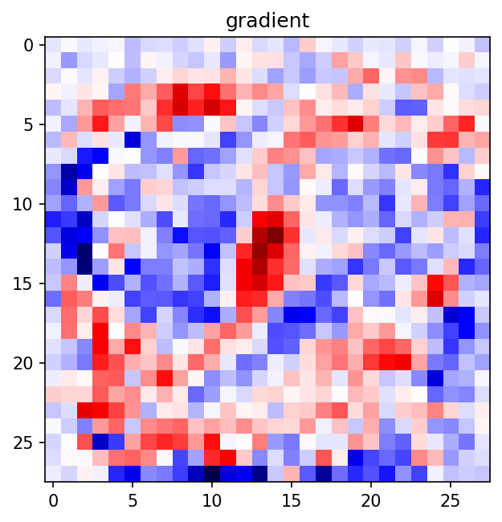
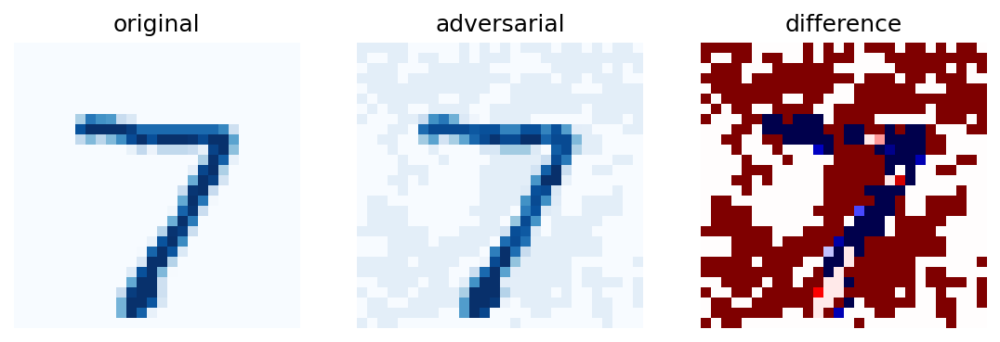
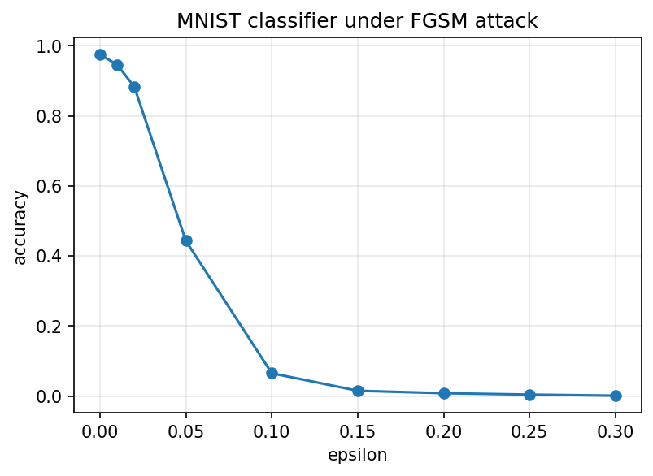

### FGSM attack on an MNIST classifier

My implementation of the Fast Gradient Sign Method, from the paper "Explaining and Harnessing
Adversarial Examples" by Goodfellow, Shlens and Szegedy (https://arxiv.org/abs/1412.6572). I
train a small network on MNIST and then attack it.

What I wanted to find out was how big the perturbation has to be before a classifier that is
right 97% of the time breaks, and whether you can see that perturbation with your eyes.

### How the attack works

A trained model maps an image to a loss. When you train, you move the weights to make that loss
small. FGSM does the opposite. It keeps the weights fixed and moves the image instead, so the
loss goes up. The perturbation is

$$\eta = \epsilon \cdot \mathrm{sign}(\nabla_x J(\theta, x, y))$$

and the adversarial image is that perturbation added to the original, then clipped back into the
range a real image can take.

$$x_{adv} = \mathrm{clip}_{[0,1]}(x + \eta)$$

Theta is the model weights, which stay fixed. x is the input image, y is its true label, J is the
loss and epsilon is the size of the perturbation. The gradient is taken with respect to x and not
theta, and that one swap is the whole difference from training.

Only the sign of the gradient is used, so every pixel moves by exactly epsilon, each one in the
direction that hurts the model. No single pixel changes much, but the first layer adds up all 784
of them, and because they all push the same way the sum moves a lot.

This is the gradient for the test image, before the sign is taken.

Red is where raising a pixel raises the loss and blue is where lowering it does. It covers the
whole 28x28 frame and not only the digit, which is why the perturbation ends up in the background
too. Taking the sign throws away the magnitudes and keeps only the direction of each pixel.

### Results

The model is a Flatten layer, then Dense(120) with relu, then Dense(10). I trained it for 5
epochs with Adam and got 97.5% accuracy on the clean test set.

At epsilon 0.1 the model stops seeing a 7 and calls it a 3, while the image still plainly looks
like a 7.

Original on the left, adversarial in the middle, and the difference between them on the right.
The difference panel is the interesting one. The attack is spread over the whole frame as a faint
pattern of +0.1 and -0.1, including the black background where there is no digit at all.

Then I ran the attack over the first 1000 test images at nine values of epsilon.

| epsilon | accuracy |
| --- | --- |
| 0.00 | 0.975 |
| 0.01 | 0.946 |
| 0.02 | 0.883 |
| 0.05 | 0.443 |
| 0.10 | 0.065 |
| 0.15 | 0.015 |
| 0.20 | 0.008 |
| 0.25 | 0.004 |
| 0.30 | 0.001 |

The part I did not expect is how fast it falls. Between epsilon 0.02 and epsilon 0.1 the model
drops from 88.3% to 6.5%, and in that range the images still look normal, so almost the whole
failure happens while the attack is still invisible.

The other thing worth noting is that at epsilon 0.15 the accuracy is 1.5%, far below the 10% you
would get by guessing. The attack is not just adding noise and confusing the model, it is pushing
it towards a specific wrong answer.

Accuracy at epsilon 0 comes out equal to the clean test accuracy. I used that as a check that the
batch path and the single image path were doing the same thing.

### Running it

Install the requirements with pip install -r requirements.txt, then run python run.py. That
trains the model, saves it as mnist_model.keras and writes the three figures into figures/.
Training takes a few minutes on CPU. The tests run with pytest.

### What is in the repo

attack.py holds input_gradient and fgsm, which are the two functions everything else uses. run.py
trains the model, runs the attack and makes the figures. tests/test_attack.py checks that the
gradient comes out with the shape of the image, that epsilon 0 changes nothing, and that the
perturbation never goes past epsilon or outside the valid pixel range. mnist_model.keras is the
trained model I used for the figures above.

### What this does not do

The attack is white box, so it needs access to the model's gradients. It is also untargeted,
meaning it pushes the prediction away from the correct label but does not choose which wrong
label it lands on. The model has no defence of any kind, so these numbers show what happens in
the easiest possible case for the attacker.

### Reference

Ian J. Goodfellow, Jonathon Shlens, Christian Szegedy. Explaining and Harnessing Adversarial
Examples. ICLR 2015. https://arxiv.org/abs/1412.6572
